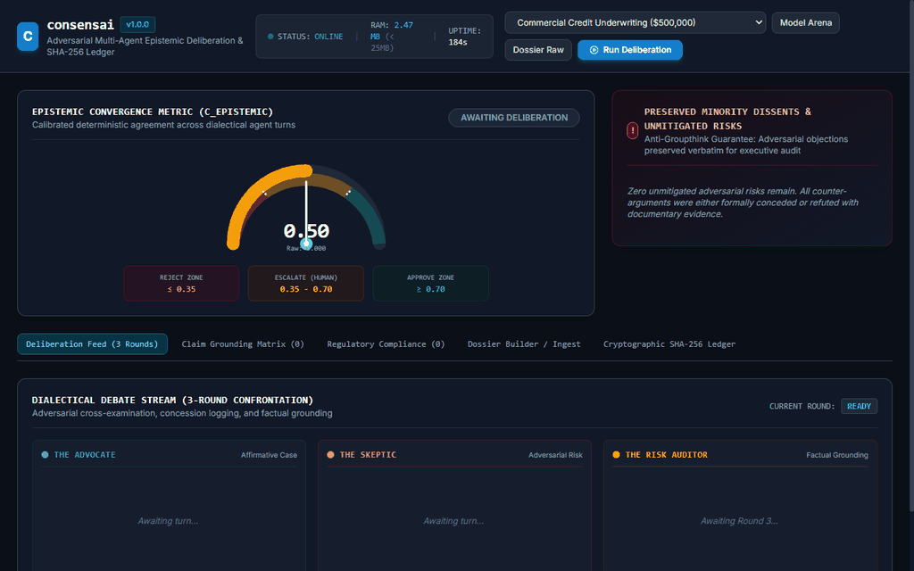
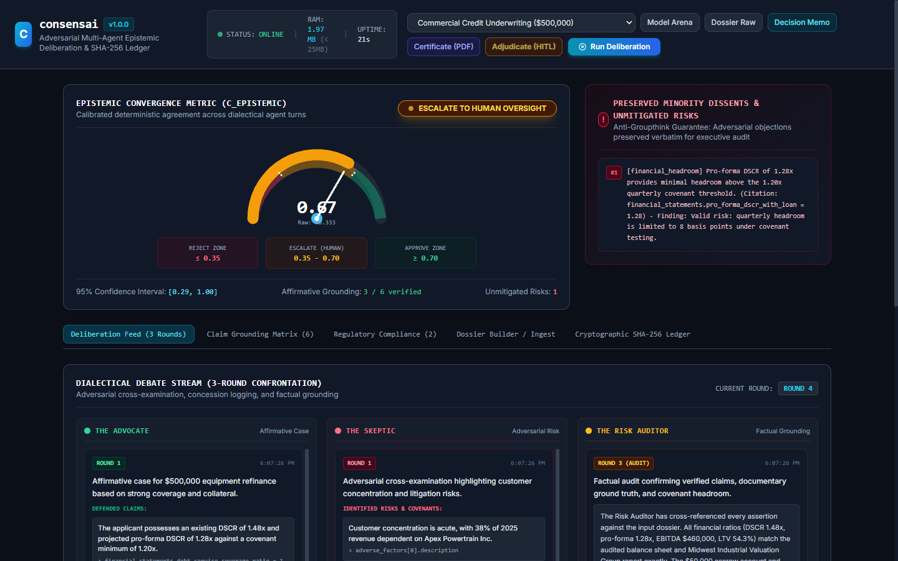
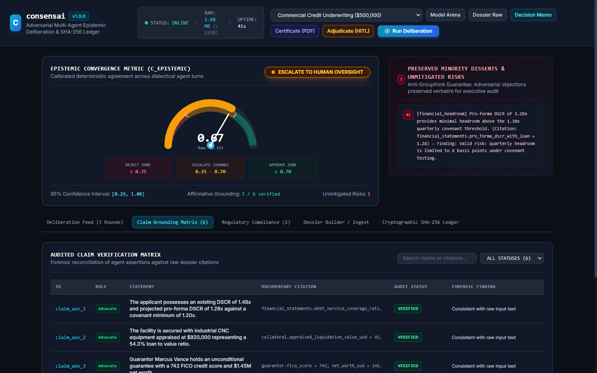
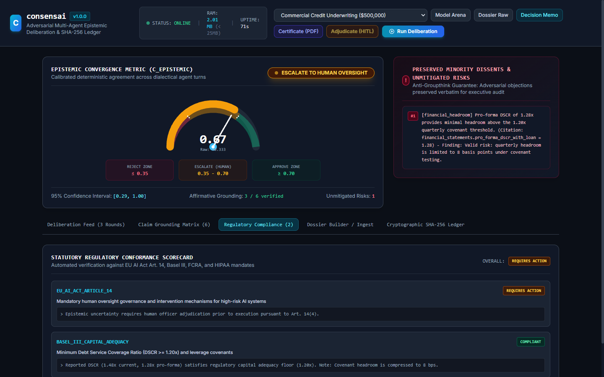
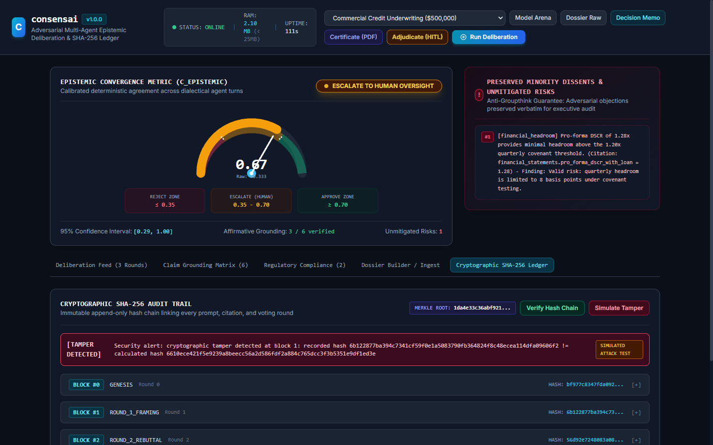
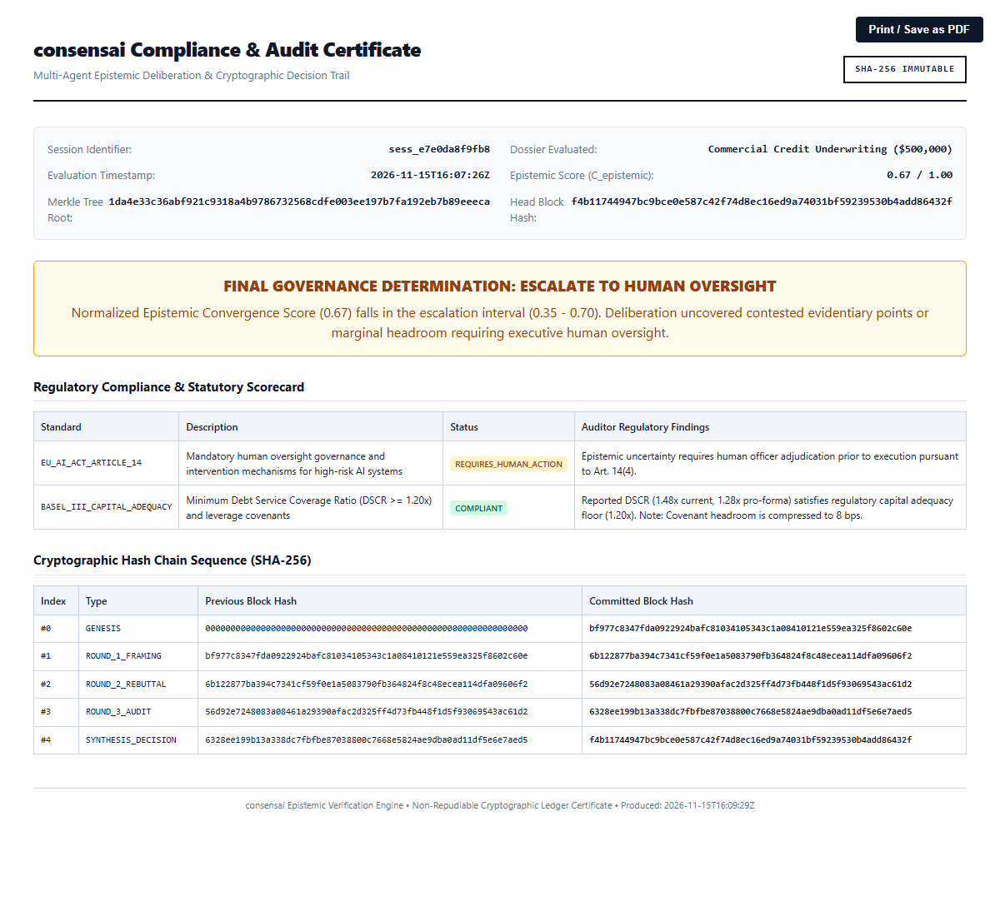
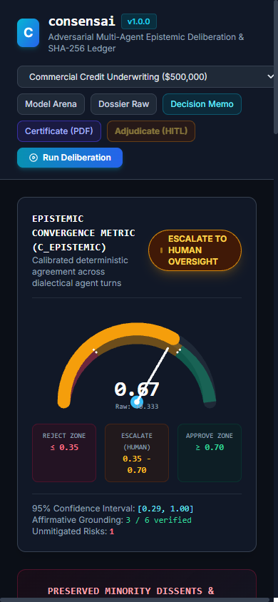

<p align="center">
  
</p>

<h1 align="center">consensai</h1>

<p align="center">
  <strong>Multi-Agent Adversarial Debate and Calibrated Consensus Decision Protocol for High-Stakes AI Automation</strong>
</p>

<p align="center">
  
  
  
  
  
</p>

---

## Overview

High-stakes corporate automation: commercial credit underwriting, fraud adjudication, high-value wire authorization, and regulatory compliance audits: cannot rely on monolithic single-agent LLM prompts. Monolithic models suffer from sycophancy, ungrounded confidence, latent training biases, and an absence of audit trails.

`consensai` replaces single-prompt decisions with a multi-agent dialectical debate protocol inspired by formal judicial arbitration. Implemented as a single, zero-dependency Go binary with an embedded React 19 web cockpit:

- **Three Specialized Adversarial Roles**: Coordinates The Advocate (affirmative case), The Skeptic (systemic downside discovery), and The Risk Auditor (factual grounding and citation verification).
- **Three-Round Confrontation State Machine**: Blind Framing, Targeted Cross-Rebuttal with documented concessions, and Citation Auditing against source dossiers.
- **Deterministic Consensus Synthesizer**: Calibrates an Epistemic Convergence Score ($C_{\text{epistemic}}$) with confidence intervals and calibrated threshold gating (Approve, Reject, or Escalate to Human Oversight).
- **Preserved Minority Dissents**: Retains unmitigated risks and counter-evidence in executive summaries, preventing artificial consensus.
- **SHA-256 Cryptographic Audit Ledger**: Records each prompt, response, citation, and voting round in an append-only hash chain with Merkle proofs.
- **Lightweight Single Binary**: Memory footprint stays under 13MB resident RAM (benchmark verified < 25MB ceiling).

---

## Demo



---

## Cockpit Interface

### 1. Live Deliberation Stream & Epistemic Convergence Gauge
Real-time three-column feed streaming structured argumentation from The Advocate, The Skeptic, and The Risk Auditor, coupled with a calibrated epistemic confidence dial.



### 2. Audited Claim Verification Matrix
Searchable assertion table detailing claim falsification status, cited figures, and discrepancy forensics audited against input source text.



### 3. Statutory Regulatory Scorecard
Automated rule engine checking compliance with EU AI Act Article 14, Basel III debt service coverage ratios (DSCR), FCRA adverse action notice mandates, and HIPAA 45 CFR section 164 data retention.



### 4. Cryptographic SHA-256 Ledger & Tamper Simulation
Block inspector displaying chained block hashes, Merkle root verification, and an interactive tamper simulation engine that detects unauthorized modification.



### 5. Printable Official Compliance Certificate
Self-contained HTML compliance certificate with official seal formatting, Merkle root digest, statutory rule checklists, and officer signature lines.



### 6. Responsive Mobile Viewport
Fully fluid layout optimized across mobile (390px), tablet (768px), and desktop displays without horizontal overflow, clipped cards, or misaligned typography.

<p align="center">
  
</p>

---

## Architecture

```
               High-Stakes Decision Input Dossier
           (Credit Application, Wire Request, BAA Review)
                               |
                               v
                     consensai Orchestrator
             (Single-Binary Go Engine, < 25MB RAM)
                               |
   +---------------------------+---------------------------+
   | Round 1: Thesis & Antithesis                          |
   | Advocate (Affirmative Case) | Skeptic (Risk Assessment)|
   +-------------------------------------------------------+
                               |
   +---------------------------+---------------------------+
   | Round 2: Targeted Cross-Rebuttal                      |
   | Evidence Exchanges and Documented Concessions         |
   +-------------------------------------------------------+
                               |
   +---------------------------+---------------------------+
   | Round 3: Factual Grounding & Citation Audit          |
   | Risk Auditor Verifies Claims Against Source Text     |
   +-------------------------------------------------------+
                               |
   +---------------------------+---------------------------+
   | Deterministic Consensus Synthesizer                   |
   | Calculates Epistemic Convergence Score (C_epistemic)  |
   | Decision: APPROVE / REJECT / ESCALATE                 |
   +-------------------------------------------------------+
                               |
   +---------------------------+---------------------------+
   | SHA-256 Chained Cryptographic Ledger                  |
   | Tamper-Proof Audit Trail with Merkle Tree Proofs     |
   +-------------------------------------------------------+
                               |
            +------------------+------------------+
            |                                     |
            v                                     v
   Embedded React 19 Cockpit             Executive Decision Memo
       (http://localhost:6060)               (Markdown, JSON, HTML)
```

---

## Advanced Enterprise Capabilities

1. **Human-in-the-Loop Adjudication (EU AI Act Art. 14)**:
   - When epistemic convergence triggers `ESCALATE TO HUMAN OVERSIGHT`, risk officers conduct interactive reviews directly in the cockpit.
   - Officers record conditional approvals, exemptions, or rejections with cryptographic digital signatures.
   - Decisions are appended as an immutable block (Block #5: `HUMAN_ADJUDICATION`) in the SHA-256 chain.

2. **Cross-Vendor Multi-Model Arena**:
   - Eliminates single-vendor cognitive bias by assigning divergent LLM providers to opposing roles (e.g. Claude 3.5 Sonnet for The Advocate, GPT-4o for The Skeptic, and deterministic heuristics for The Risk Auditor).

3. **Interactive Dossier Builder & Playground**:
   - Ingests custom JSON, text, or markdown dossiers via drag-and-drop.
   - Includes preconfigured templates for commercial credit underwriting, wire fraud adjudication, HIPAA compliance, jumbo mortgages, and AML PEP screening.

4. **Real-Time What-If Sensitivity Analyzer**:
   - Calibrates decision boundaries ($\theta_{\text{approve}}$ and $\theta_{\text{reject}}$) on the fly with dynamic risk frontier recalculations, requiring zero additional LLM inference tokens.

5. **Merkle Tree Proofs & Institutional Certificate**:
   - Computes a binary Merkle tree over all audited assertions and claims.
   - Exports printable official certificates with cryptographic verification seals, Merkle root digests, and regulatory compliance tables.

6. **Statutory Regulatory Checklist**:
   - Evaluates mandatory legal parameters: Basel III capital covenants (DSCR > 1.20x), FCRA consumer rights disclosures, and HIPAA 6-year retention policies.

---

## Epistemic Convergence Metric

The orchestrator computes the Epistemic Convergence Score ($C_{\text{epistemic}}$):

$$C_{\text{epistemic}} = \frac{|\mathcal{A} \cap \mathcal{V}| - |\mathcal{S}_{\text{unmitigated}}|}{|\mathcal{A}| + |\mathcal{S}|}$$

Where:
- $\mathcal{A}$: Set of claims defended by the Advocate.
- $\mathcal{S}$: Set of risks and failure points identified by the Skeptic.
- $\mathcal{V}$: Set of claims verified against the source dossier by the Risk Auditor.
- $\mathcal{S}_{\text{unmitigated}}$: Validated risks left unmitigated by the Advocate.

### Decision Boundaries

- **APPROVE**: $C_{\text{epistemic}} \ge 0.70$
- **REJECT**: $C_{\text{epistemic}} \le 0.35$
- **ESCALATE TO HUMAN OVERSIGHT**: $0.35 < C_{\text{epistemic}} < 0.70$

Calibrated confidence intervals are computed using the standard error:

$$SE = \sqrt{\frac{C(1-C)}{N}}, \quad CI_{95} = [C - 1.96 \cdot SE, \; C + 1.96 \cdot SE]$$

---

## Installation

### Prerequisites

- Go 1.22 or later
- Node.js 20 or later (for web cockpit building)

### Build from Source

```bash
# Clone the repository
git clone https://github.com/alexandrmotologa/consensai.git
cd consensai

# Build the embedded React 19 cockpit
cd web
npm install
npm run build
cd ..

# Compile the single Go binary
go build -o bin/consensai.exe ./cmd/consensai
```

---

## CLI Usage

### 1. Run Deliberation via CLI

Run a full three-round dialectical debate over a business dossier:

```bash
./bin/consensai debate --dossier examples/dossiers/commercial_loan_500k.json
```

Run with custom LLM provider and export audit artifacts:

```bash
./bin/consensai debate \
  --dossier examples/dossiers/wire_fraud_investigation.json \
  --provider openai \
  --model gpt-4o \
  --output report.md \
  --ledger audit.json
```

### 2. Launch the Embedded Web Cockpit

Start the HTTP service on port 6060:

```bash
./bin/consensai serve --port 6060
```

Open `http://localhost:6060` to access the interactive web cockpit.

### 3. Verify Cryptographic Ledger Integrity

Validate the SHA-256 hash chain and Merkle proofs of an audit ledger:

```bash
./bin/consensai verify --ledger audit.json
```

### 4. Generate Formal Decision Memo

Generate a Markdown or HTML executive decision memo:

```bash
./bin/consensai memo --ledger audit.json --format markdown --out memo.md
```

---

## Configuration

Configuration parameters are managed via `consensai.yaml` or environment variables:

```yaml
version: "1.0"
server:
  port: 6060
  cors_allowed_origins: ["*"]

provider:
  default: "mock" # options: mock, openai, anthropic, gemini, ollama
  api_key_env: "OPENAI_API_KEY"
  model: "gpt-4o"
  temperature: 0.2

protocol:
  max_rounds: 3
  thresholds:
    approve: 0.70
    reject: 0.35
  strict_citations: true
  min_citation_coverage: 0.80

ledger:
  storage_path: "./ledgers"
  hash_algorithm: "sha256"
```

---

## Verification & Benchmarks

Run the complete test suite including unit tests, integration tests, and memory benchmarks:

```bash
go test -v ./...
```

Benchmark results:
```
=== RUN   TestMemoryFootprintUnder25MB
    benchmark_test.go:78: Allocated Memory: 0.24 MB, System Memory: 12.27 MB
--- PASS: TestMemoryFootprintUnder25MB (0.02s)
```

---

## Repository Structure

```
consensai/
├── cmd/
│   └── consensai/           # CLI entry point (main.go)
├── internal/
│   ├── config/              # Configuration schemas and parser
│   ├── agent/               # Agent roles, prompt templates, and LLM clients
│   ├── protocol/            # Dialectical engine, state machine, and synthesizer
│   ├── ledger/              # SHA-256 block structure, chain validation, Merkle proofs
│   ├── report/              # Memo generator, printable certificate, terminal printer
│   └── server/              # HTTP API, SSE streaming, embedded React assets
├── web/                     # React 19 dashboard (Vite, TypeScript, Tailwind)
├── examples/
│   ├── consensai.yaml       # Example configuration
│   └── dossiers/            # Sample dossiers (credit, fraud, HIPAA)
├── docs/
│   ├── ARCHITECTURE.md      # Detailed system specifications
│   ├── DECISION_PROTOCOL.md # Mathematical consensus foundations
│   ├── API.md               # REST and SSE API specifications
│   └── images/              # Authentic software execution assets
├── Makefile
├── go.mod
└── README.md
```

---

## License

Apache License 2.0. See [LICENSE](LICENSE) for details.
